<div align="center">

# Nookly

**Una barra de tareas para Windows con un personaje que te acompaña.**

[](LICENSE)
[](https://github.com/fate-9x/nook/releases/latest)
[](https://github.com/fate-9x/nook/commits/main)

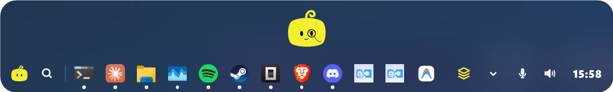

</div>

Nookly es una barra flotante que se coloca en un borde de la pantalla. En ella tienes tus
aplicaciones, grupos de apps, textos guardados para copiar con un clic y la hora. Arriba vive su
personaje, que mira el cursor, baila cuando suena música y avisa de las notificaciones.

Con **[Nookly Pro](#nookly-pro)** además puede sustituir por completo a la barra de tareas de
Windows, con las apps abiertas, el área de notificación, el buscador con la tecla Windows y los
controles de la música, el volumen y el micrófono. En este manual, lo que es solo de Nookly Pro
lleva la marca ⭐ **Pro**.

## Índice

- [Instalación](#instalación)
- [Nookly Pro](#nookly-pro)
- [La barra](#la-barra)
- [Aplicaciones y grupos](#aplicaciones-y-grupos)
- [Buscar y abrir aplicaciones](#buscar-y-abrir-aplicaciones)
- [Bóveda de textos](#bóveda-de-textos)
- [Música, volumen y micrófono](#música-volumen-y-micrófono)
- [La hora y las notificaciones](#la-hora-y-las-notificaciones)
- [El personaje](#el-personaje)
- [Addons](#addons)
- [Dónde va la barra](#dónde-va-la-barra)
- [Sustituir la barra de tareas de Windows](#sustituir-la-barra-de-tareas-de-windows)
- [Atajos de teclado](#atajos-de-teclado)
- [Configuración](#configuración)
- [Actualizaciones](#actualizaciones)
- [Desinstalar](#desinstalar)
- [Preguntas frecuentes](#preguntas-frecuentes)
- [Para desarrolladores](#para-desarrolladores)
- [Licencia y créditos](#licencia-y-créditos)

## Instalación

1. Descarga **`nook-setup.exe`** de la [última versión](https://github.com/fate-9x/nook/releases/latest).
2. Ábrelo y sigue los pasos. Puedes elegir la carpeta (por defecto, la de tu usuario), si Nookly se
   inicia con Windows y si quieres un acceso directo en el escritorio.
3. Al terminar, Nookly aparece arriba, en el centro de la pantalla.

No necesitas permisos de administrador: Nookly se instala solo para tu usuario. Así puede
actualizarse solo (ver [Actualizaciones](#actualizaciones)), y por eso el instalador no te deja
elegir una carpeta protegida, como *Archivos de programa*.

> **Requisitos:** Windows de 64 bits. Nookly se desarrolla y se prueba en Windows 11.

## Nookly Pro

Nookly Pro es la versión de pago de Nookly, en la Microsoft Store. Tiene todo lo de la versión
gratuita y además:

| Función | Qué hace |
|---|---|
| **Sustituir la barra de tareas de Windows** | Nookly ocupa su sitio, con las [apps abiertas](#abrir-y-cambiar-de-app), el [área de notificación](#sustituir-la-barra-de-tareas-de-windows) y la barra abajo. |
| **Buscar y abrir aplicaciones** | La [lupa](#buscar-y-abrir-aplicaciones), su atajo y la tecla Windows. |
| **Reproductor** | Lo que suena, con sus controles, en la barra o con un clic en el personaje. |
| **Volumen y micrófono** | Botones para el [volumen y el micrófono](#música-volumen-y-micrófono), y el atajo para silenciarlo. |
| **Ocultarse a pantalla completa** | La barra desaparece mientras juegas o ves algo a pantalla completa. |
| **La hora** | Un clic abre las notificaciones y el calendario de Windows. |

En la versión gratuita, estas opciones salen en la configuración con la marca **PRO**.

## La barra

De izquierda a derecha, la barra tiene:

| Parte | Qué hace |
|---|---|
| **Botón del personaje** | Abre la [configuración](#configuración). Si hay una versión nueva, lleva un punto. |
| **Lupa** ⭐ **Pro** | Abre el [buscador de aplicaciones](#buscar-y-abrir-aplicaciones). |
| **Tus apps** | Las que fijaste en la barra y los grupos. Con Nookly Pro, antes van las abiertas (con un punto). |
| **Bóveda** | El icono de las tarjetas: abre la [bóveda de textos](#bóveda-de-textos). |
| **Addons** | Un botón por cada [addon](#addons) instalado: abre su panel. |
| **Música** ⭐ **Pro** | Si suena algo: la portada y los botones de anterior, pausa y siguiente (opcional). |
| **Área de notificación** ⭐ **Pro** | Los iconos de los demás programas, si Nookly [sustituye a la barra de Windows](#sustituir-la-barra-de-tareas-de-windows). |
| **Micrófono y volumen** ⭐ **Pro** | Silenciar el micrófono y el volumen general de Windows. |
| **Hora** | La hora. Con Nookly Pro, un clic abre las notificaciones y el calendario de Windows. |

Al pasar el cursor por encima de los iconos, el que tiene el cursor se agranda (efecto lupa).
También puedes recorrerlos con la rueda del ratón.

## Aplicaciones y grupos

### Abrir y cambiar de app

- **Clic en una app:** la abre. Con Nookly Pro, si ya está abierta, trae su ventana; si ya estaba
  delante, la minimiza o pasa a la siguiente ventana de esa app.
- ⭐ **Pro** Las **apps abiertas** salen primero, con un punto, en el orden en que las abriste.
  Las que tienes fijadas en la barra no se repiten.
- ⭐ **Pro** **Clic derecho en una app abierta:** abrir otra ventana, fijarla en la barra (o
  quitarla) y cerrar la ventana.

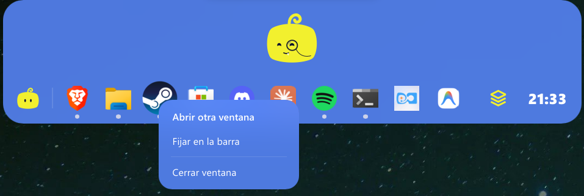

### Añadir apps

- Acerca el cursor al final de la última app: aparece el botón **+**. Un clic abre un buscador
  con las aplicaciones instaladas (las mismas del menú Inicio, también las de la Tienda) para
  añadir la que elijas.
- **Clic derecho en el +:** añadir una app o crear un **grupo nuevo**.
- **Arrastra archivos o accesos directos** desde el Explorador hasta el **+** para añadirlos, o
  hasta un grupo para meterlos en él.
- **Cambiar el orden:** arrastra una app a lo largo de la barra.
- **Quitar:** clic derecho → *Quitar de la barra* (o *Eliminar grupo*).

### Grupos

Un grupo junta varias apps en un solo botón. Al pulsarlo se despliega:

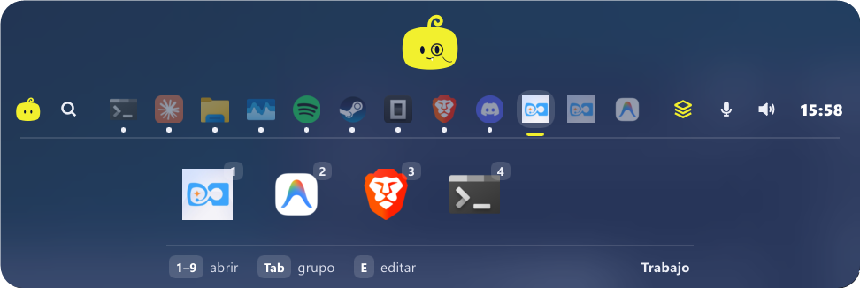

- **1–9** abre la app con ese número; **Tab** pasa al grupo siguiente; **E** entra en modo
  edición (para cambiarle el nombre, el icono o quitar apps); **Esc** lo cierra.
- Cada app y cada grupo de la barra tiene su atajo global, **Alt+Shift+1**, **Alt+Shift+2**…
  (se asignan solos y se cambian en *Configuración → Atajos*).

## Buscar y abrir aplicaciones

⭐ **Pro** La **lupa** (o **Alt+Shift+B**) abre un buscador para abrir cualquier aplicación instalada:
escribe, elige con las flechas y pulsa **Intro**. Se abre listo para escribir, y su borde se
resalta cuando el campo tiene el foco.

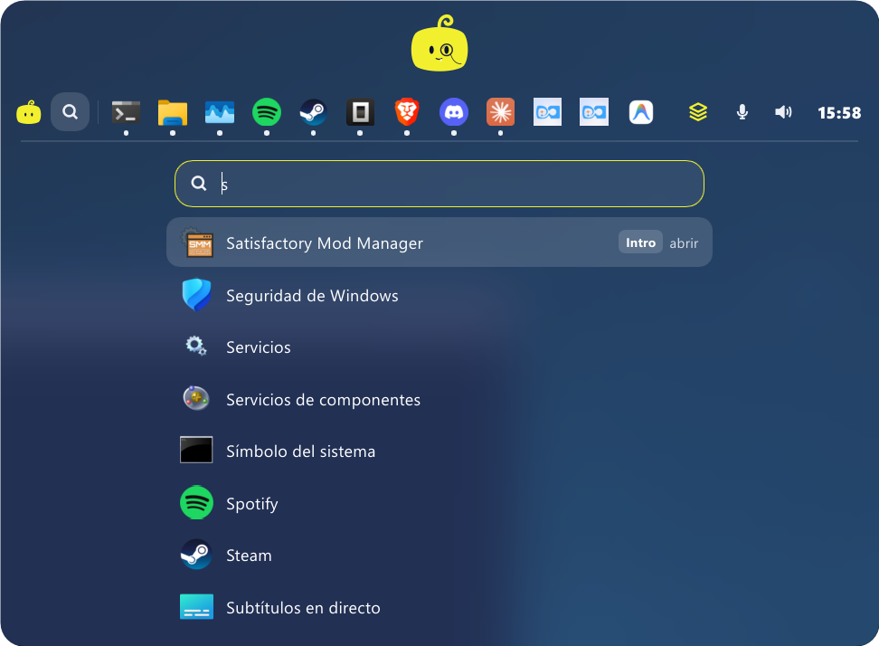

**La tecla Windows también puede abrirlo**, en lugar del menú Inicio: actívalo en
*Configuración → Comportamiento → La tecla Windows abre el buscador de Nookly*. Solo la tecla
Windows pulsada sola: las combinaciones (Win+E, Win+R, Win+D…) siguen funcionando, y
**Ctrl+Esc** sigue abriendo el menú Inicio.

Para que funcione también cuando tienes delante un programa abierto como administrador, Nookly
pide permiso de administrador **una sola vez**, al encender la opción. El botón **(?)** junto a
la opción explica por qué:

- Windows no deja que un programa vea las teclas que se pulsan en los programas abiertos como
  administrador. Por eso Nookly prepara un pequeño **ayudante**: una copia de Nookly en la carpeta
  *Nook Ayudante* de Archivos de programa, que una tarea programada abre con permisos de
  administrador.
- El ayudante **solo vigila la tecla Windows** y le avisa a Nookly. Se cierra al cerrar Nookly y se
  quita al desinstalarlo. Nookly sigue funcionando sin permisos.
- Si no das el permiso, la opción funciona igual, salvo con esos programas.

## Bóveda de textos

La bóveda guarda textos que usas a menudo (respuestas, direcciones, comandos…) para copiarlos con
un clic. Ábrela con el icono de las tarjetas o con **Alt+Shift+V**.

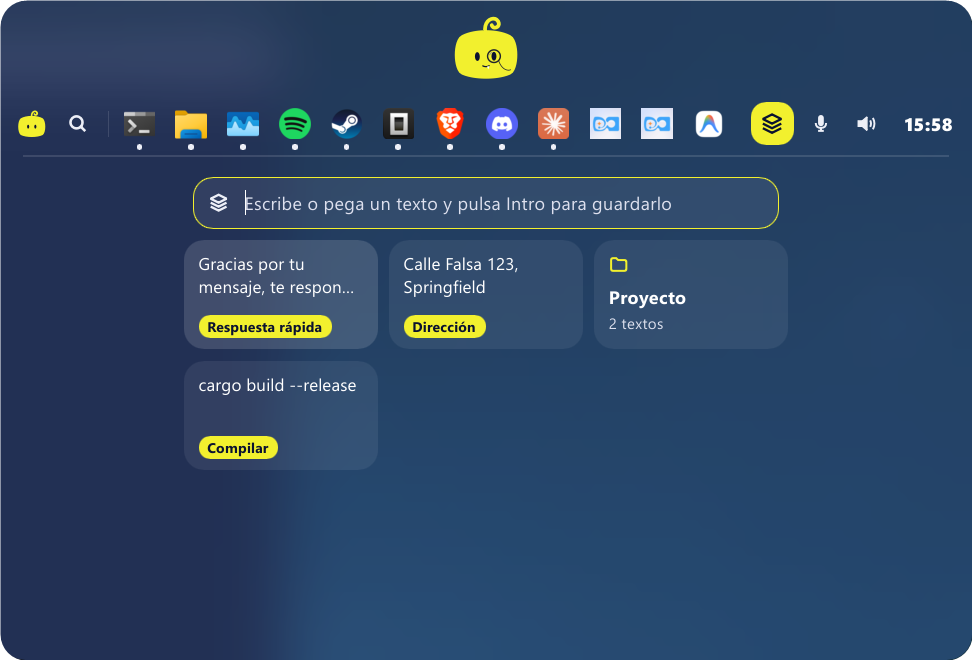

- **Guardar:** escribe o pega un texto y pulsa **Intro**.
- **Copiar:** clic en la tarjeta. Con la bóveda abierta, **Alt+Shift+V** copia la marcada.
- **Clic derecho en una tarjeta:** copiar, poner o quitar una **etiqueta**, sacarla de su grupo o
  eliminarla.
- **Agrupar:** arrastra un texto sobre otro para crear un grupo, o sobre un grupo para meterlo.
- **Sincronizar entre ordenadores (opcional):** en *Configuración → Comportamiento → Cuenta*,
  conecta tu cuenta de GitHub. La bóveda se guarda en un Gist secreto de tu cuenta, y Nookly solo
  pide permiso sobre tus Gists.

La bóveda se puede desactivar en *Configuración → Comportamiento → Bóveda de textos*.

## Música, volumen y micrófono

⭐ **Pro** Todo lo de esta sección es de Nookly Pro. En la versión gratuita, el personaje baila
igual cuando suena música.

**Volumen:** clic en el altavoz para ver el dispositivo de salida, el volumen y el botón de
silencio. La **rueda del ratón** sobre el altavoz sube o baja el volumen.

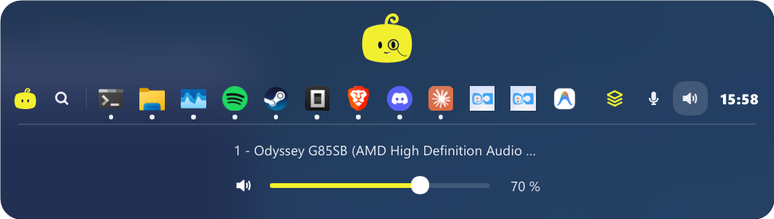

**Micrófono:** un clic lo silencia o lo vuelve a activar. Silenciado, el botón se pinta del color
de acento. Atajo: **Alt+Shift+M**.

**Música:** Nookly detecta lo que suena en Spotify, los navegadores y demás reproductores (los
mismos que salen en los controles multimedia de Windows). Puedes elegir en *Configuración →
Música* dónde están los controles:

- **En la barra:** la portada y los botones de anterior, pausa y siguiente aparecen en la tira
  mientras suena algo. La portada abre el reproductor.
- **En el personaje:** haz clic en el personaje mientras suena algo para abrir el reproductor.

En el reproductor ves qué suena y puedes cambiar el volumen de esa app.

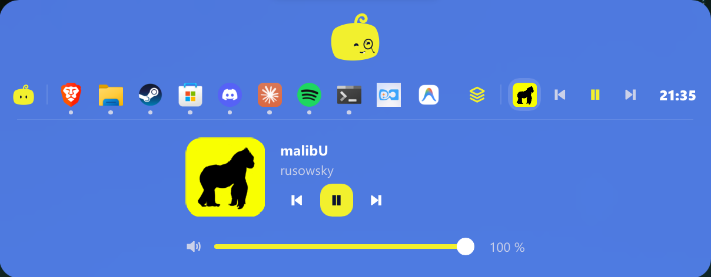

## La hora y las notificaciones

- ⭐ **Pro** **Clic en la hora:** abre las notificaciones y el calendario de Windows, como en su
  barra.
- **Cuando llega una notificación**, el personaje lo cuenta con una animación (y, con la barra
  oculta, se asoma un poco más) hasta que llevas el cursor a la barra.

## El personaje

- **Te mira:** sigue el cursor con los ojos; con el cursor quieto, mira a su aire.
- **Baila** cuando suena música.
- **Clic:** rebota. Con **cinco clics seguidos** aparece un segundo personaje durante un rato.
- **Cursor encima:** muestra su nombre. **Clic derecho:** el menú de Nookly (mostrar u ocultar,
  añadir aplicación, nuevo grupo, configuración y cerrar).
- **Personalízalo** en *Configuración → Personaje*: elige la figura (**Nook** o **Limón**), ponle
  accesorios (audífonos, corona, gorro, gafas, monóculo…) y cambia su color. El icono de Nook en
  el área de notificación de Windows cambia con él.

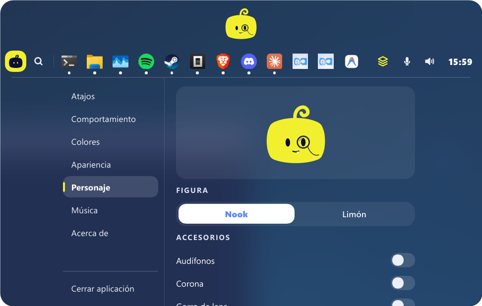

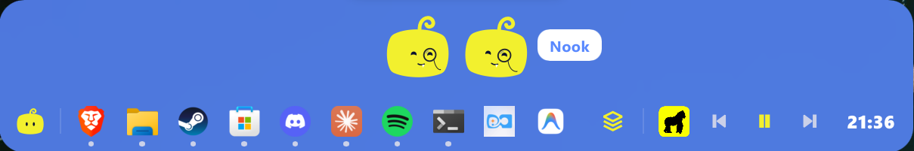

## Addons

Los addons son paneles que se añaden a la barra, como minijuegos. Se instalan en
*Configuración → Addons*, que muestra los disponibles (del repositorio
[nook-addons](https://github.com/fate-9x/nook-addons)), y cada uno pone un botón en la barra que
abre su panel. Solo se cargan al abrirlos: si no los usas, no gastan nada.

- **Actualizar o quitar:** en la misma sección. El interruptor **En la barra** oculta su botón sin
  desinstalarlo.
- **Con tu IA:** algunos addons se pueden usar desde Claude u otra IA que admita MCP (por
  ejemplo, para jugar contra ella). En *Configuración → Addons*, **Conectar con Claude Desktop**
  añade Nookly a Claude Desktop (después hay que reiniciarlo), y **Copiar comando para Claude Code**
  copia el comando que lo añade a Claude Code. Luego basta con pedírselo en el chat: lo que haga se
  ve en la barra.

Los addons no pueden leer tus archivos ni conectarse a internet. Para hacer uno, mira el
[README de nook-addons](https://github.com/fate-9x/nook-addons#readme).

## Dónde va la barra

**Arrastra la barra** (desde el personaje o desde un hueco de la tira) y suéltala:

- en el **tercio izquierdo** o **derecho** de la pantalla, va a ese **lateral**;
- en el **centro**, va **arriba**;
- ⭐ **Pro** en la **mitad de abajo**, va **abajo**, pero solo si Nookly
  [sustituye a la barra de Windows](#sustituir-la-barra-de-tareas-de-windows) (si no, estaría
  en el mismo sitio que ella).

También se elige en *Configuración → Apariencia → Posición*. Con varios monitores, la barra va
al monitor en el que la sueltes.

<p align="center">
  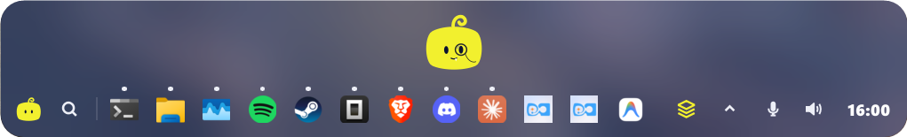
</p>
<p align="center">
  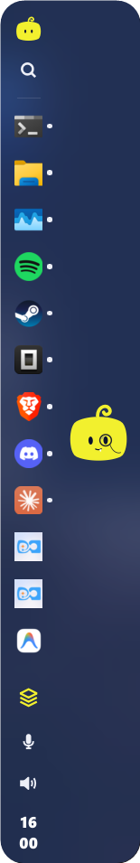
</p>

**Ocultarse:**

- **Ocultar en reposo:** cuando alejas el cursor, la barra se esconde y solo asoma el
  personaje desde el borde. Pasa el cursor por ahí para que vuelva.

  

- ⭐ **Pro** **Ocultar con juegos y apps a pantalla completa:** la barra y el personaje desaparecen mientras
  juegas o ves algo a pantalla completa (con su atajo se puede abrir igual).
- **Alt+Shift+Espacio** la muestra u oculta en cualquier momento.

## Sustituir la barra de tareas de Windows

⭐ **Pro** En *Configuración → Comportamiento → Sustituir la barra de tareas de Windows*, Nookly oculta la
barra de Windows mientras está abierto y la devuelve como estaba al cerrarlo. Con esta opción:

- **Área de notificación:** los iconos de los demás programas (Discord, Steam, el antivirus…)
  aparecen en la tira, junto al micrófono. Los que Windows tiene a la vista van en la tira; el
  resto, en una ventanita que se abre con la **flecha**. Un clic o un clic derecho en un icono le
  llega a su programa, igual que en Windows.
- **La barra se puede poner abajo.**

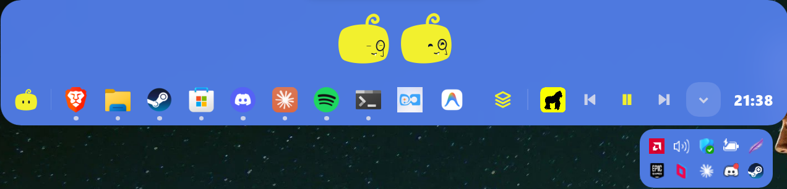

> **Iconos que no aparecen:** al abrirse, Nookly les pide su icono a los programas que ya estaban
> abiertos, pero algunos no responden (los que funcionan como administrador, por ejemplo, porque
> Windows no deja que Nookly se lo pida). Si falta alguno, reinicia ese programa, o activa *Iniciar
> con Windows* para que Nookly arranque antes que ellos: los programas que arrancan después le
> envían su icono solos.

## Atajos de teclado

Funcionan en cualquier momento, aunque la barra esté oculta. Todos se cambian o se quitan en
*Configuración → Atajos* (haz clic en uno y pulsa la combinación nueva; **Supr** lo deja sin
atajo).

| Atajo | Qué hace |
|---|---|
| **Alt+Shift+Espacio** | Mostrar u ocultar la barra |
| **Alt+Shift+1** … **9** | Abrir la app o el grupo con ese número |
| **Alt+Shift+B** ⭐ **Pro** | Buscar y abrir una aplicación |
| **Alt+Shift+V** | Abrir la bóveda (abierta: copiar el texto marcado) |
| **Alt+Shift+M** ⭐ **Pro** | Silenciar o activar el micrófono |
| **Win** *(opcional)* ⭐ **Pro** | Abrir el buscador de Nookly en lugar del menú Inicio |

Dentro de la barra:

| Tecla | Dónde | Qué hace |
|---|---|---|
| **1–9** | Grupo abierto | Abrir la app con ese número |
| **Tab** | Grupo abierto | Pasar al grupo siguiente |
| **E** | Grupo abierto | Editar el grupo |
| **↑ ↓ Intro** | Buscador | Elegir y abrir |
| **Esc** | Cualquier panel | Cerrarlo |

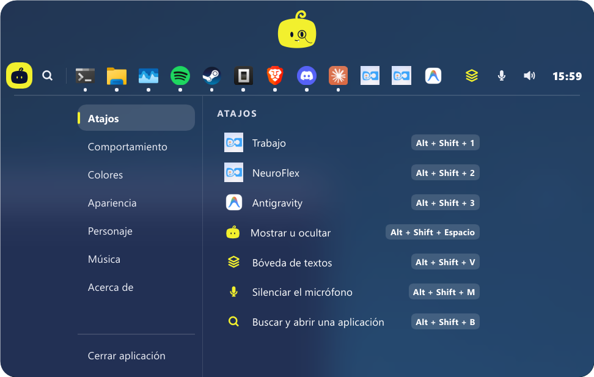

## Configuración

Se abre con el **botón del personaje**, al principio de la barra (o con clic derecho en el
personaje → *Configuración*).

| Sección | Qué hay |
|---|---|
| **Atajos** | Los atajos de cada app, de cada grupo y de las funciones de Nookly. |
| **Comportamiento** | Ocultar en reposo, iniciar con Windows, mostrar la hora, la bóveda y su cuenta, y las animaciones. Con Nookly Pro, también ocultar a pantalla completa, sustituir la barra de Windows, la tecla Windows y los botones de las apps abiertas, el sonido, el micrófono y la lupa. |
| **Colores** | El color de fondo y el de acento (con los tuyos propios) y *presets* para guardar combinaciones. |
| **Apariencia** | Transparencia, opacidad, tamaño, posición e idioma (español, inglés, japonés o coreano). |
| **Personaje** | La figura, los accesorios y sus colores. |
| **Música** ⭐ **Pro** | Si el reproductor va en la barra o se abre con el personaje. |
| **Addons** | Instalar, actualizar y quitar [addons](#addons), y conectarlos con tu IA. |
| **Acerca de** | La versión, las actualizaciones y los créditos. |

<table>
  <tr>
    <td>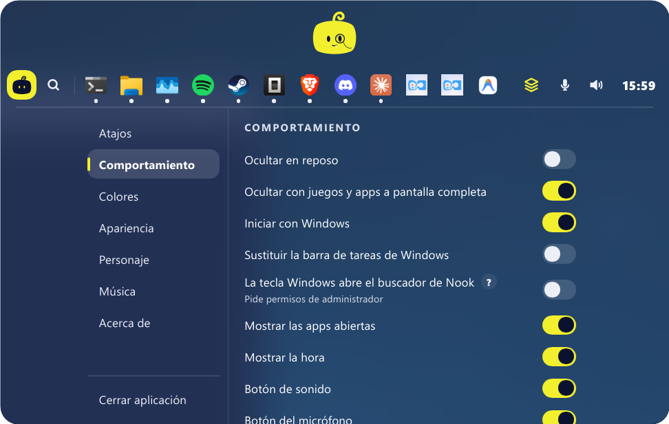</td>
    <td>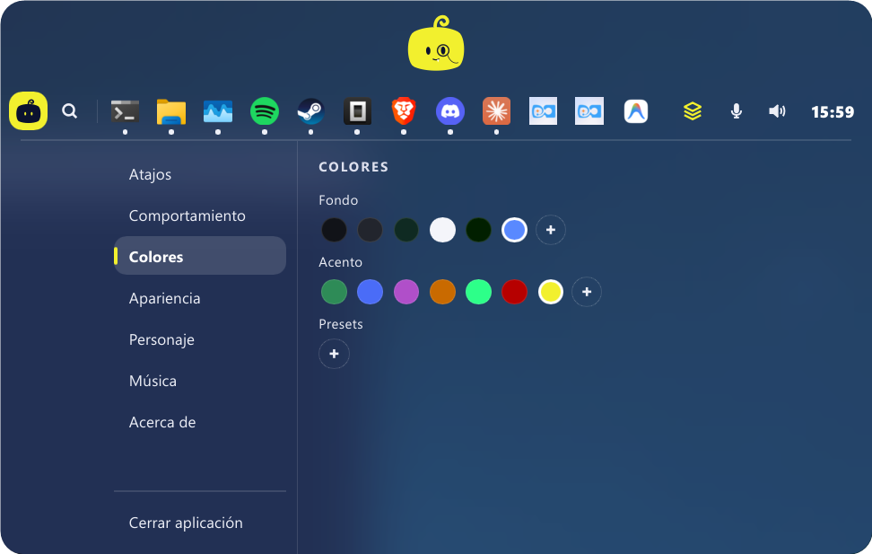</td>
  </tr>
</table>

## Actualizaciones

Nookly comprueba si hay una versión nueva. Cuando la hay, el botón del personaje lleva un punto: en
*Configuración → Acerca de*, pulsa **Actualizar**. Nookly descarga la versión nueva, se cierra y se
vuelve a abrir ya actualizado. Las novedades de cada versión están en
[Releases](https://github.com/fate-9x/nook/releases).

## Desinstalar

Desde *Configuración de Windows → Aplicaciones → Aplicaciones instaladas → Nookly → Desinstalar*.
El desinstalador te pregunta si quieres borrar también tus ajustes, grupos y textos guardados
(si vas a volver a instalarlo, contesta que no). Si activaste la tecla Windows con permisos de
administrador, Windows pide permiso para quitar también el ayudante.

## Preguntas frecuentes

**La barra de Windows no volvió al cerrar Nookly.**
Pasa si Nookly se cierra de golpe (por ejemplo, desde el Administrador de tareas). Ábrelo y
ciérralo desde su menú (*Cerrar aplicación*): la devuelve como estaba.

**Al pulsar la tecla Windows se abre el menú Inicio.**
Comprueba que la opción esté activada en *Comportamiento*. Si pasa solo con un programa abierto
como administrador, apaga y vuelve a encender la opción y acepta el permiso.

**¿Dónde se guardan mis datos?**
En `%APPDATA%\nook\grupos.json` (grupos, ajustes y bóveda). Si conectas tu cuenta de GitHub, la
bóveda también se guarda en un Gist secreto tuyo.

## Para desarrolladores

Nookly está hecho en **Rust** con **[Slint](https://slint.dev)** para la interfaz.

```bash
cargo build --release   # target\release\nook.exe
cargo test
```

- `src/main.rs` tiene el estado y arranca todo; cada parte de la barra está en `src/barra/`
  (bóveda, buscador, configuración, personaje…), y su interfaz en `ui/`.
- Las funciones de Nookly Pro se apoyan en unos pocos módulos que en este repositorio están en
  `src/gratis/`, en una versión que no hace nada (el código de verdad es privado).
- Las traducciones están en `lang/<idioma>/LC_MESSAGES/nook.po`.
- Los addons (`src/addons/`) se cargan en tiempo de ejecución: su interfaz con el intérprete de
  Slint y su lógica con [Rhai](https://rhai.rs). `nook.exe --mcp` es el servidor MCP que los
  conecta con la IA del usuario.
- El instalador se compila con [Inno Setup 6](https://jrsoftware.org/isinfo.php):
  `ISCC /DVersion=0.0.0 instalador\nook.iss` (después de `cargo build --release`).
- Las versiones se publican subiendo un tag `vX.Y.Z`: el workflow compila `nook.exe` y el
  instalador y escribe las notas a partir de los commits.

La guía completa para contribuir (convención de commits, notas de las versiones, cómo publicar)
está en [AGENTS.md](AGENTS.md).

## Licencia y créditos

Nookly se publica bajo la [licencia MIT](LICENSE). Qué datos usa y adónde van: [política de
privacidad](PRIVACIDAD.md).

Usa trabajo de otras personas: la técnica de dibujo y animación del personaje viene de
[bloub](https://github.com/jeremy-prt/bloub), la interfaz de [Slint](https://slint.dev) y varias
bibliotecas de Rust. Los detalles y sus licencias están en
[AVISOS_DE_TERCEROS.md](AVISOS_DE_TERCEROS.md) y, dentro de Nookly, en *Configuración → Acerca de →
Ver licencias*.
